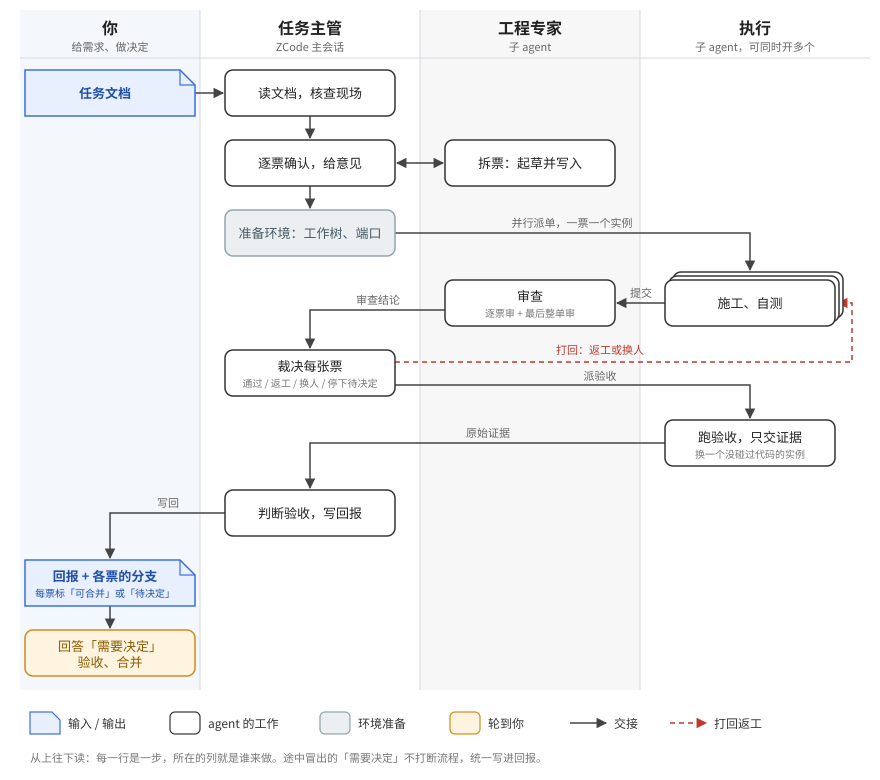

# Loom

**一套以本地开发为主、针对 ZCode 环境深度优化的多 agent 编排工程范式。** 你交给它一份写清楚的需求，它让几个分工不同的 agent 协作，把需求推进到稳定可合并的实现。

<p align="center"></p>

它由三部分组成：一个 agent skill（给主会话读），以及两份角色提示词（分别给专家和执行 agent）。

## 什么时候用

| 适合用 loom | 换别的方式 |
|---|---|
| 需求已经写清楚，能拆成两张以上可以并行的工程票 | 需求还在讨论：先和真人把需求谈清楚 |
| 一份交接单，要做成「施工 + 审查 + 验收」的完整交付 | 改一个按钮的颜色、修一处拼写：直接做更快 |
| 想让便宜的模型多干活，同时保住质量 | 纯调研、写方案，没有施工 |

一句话判断：**要做什么已经确定，剩下的是怎么做好**，就用 loom。还在决定要做什么，就不要用。需求讨论、方案评审和重要决策仍然需要真人参与。loom 碰到这类问题不会自己拍板，而是停下来，写成「需要决定」交还给你。

## 三个角色：为什么这样分

一次工程任务里，**绝大部分工作量是写代码、跑测试；真正需要判断力的只有少数几个节点**：怎么拆、拆得对不对、写得对不对、能不能交。

如果全程都用最强的模型，又贵又慢。全程都用便宜的模型，质量又守不住。loom 的做法是按工作性质分配模型：

- 把**贵而强**的模型放在少数判断节点上，这是**工程专家**；
- 把**快而省**的模型放在大量施工上，这是**执行**；
- 再用一个模型专门**盯全局、管流程**，它不碰代码细节，上下文才能一直保持清醒，这是**任务主管**。

可以这样记：主管是项目经理，专家是技术负责人兼监理，执行是施工队。

### 每个角色做什么

| | 任务主管 | 工程专家 | 执行 |
|---|---|---|---|
| 它是谁 | 你直接对话的 ZCode 主会话，读的是 loom skill | 主管叫来做判断的子 agent | 主管派去干活的子 agent，可以同时开好几个 |
| 做什么 | 读需求、核查现场、确认票据、决定派谁和怎么并行、准备环境、判断验收能不能过、写回报 | 拆票（起草和写入）、审查代码 | 照票写代码、自测、提交；也可以按主管给的命令跑验收，只交原始证据 |
| 绝不做 | 自己写代码，替子 agent 改代码 | 施工；决定派谁、怎么并行 | 给自己施工的票判验收 |

两个词要分清：**审查**是判断代码写得对不对，由专家做；**验收**是实际跑起来看是不是真的对，由主管判断。

### 怎么给每个角色选模型

| | 任务主管 | 工程专家 | 执行 |
|---|---|---|---|
| 最看重 | **守纪律、有耐心**：能等子 agent 回来，不会自己动手；长时间工作不走样；工具调用稳定 | **工程判断力**：看得出拆票哪里不对、代码哪里有真问题，也知道什么不算问题 | **照票办事**：指令明确时做得准、不越界、速度快 |
| 不太重要 | 写代码的水平 | 速度和价格（一次任务只叫它几次） | 自己拿主意的能力（票已经写清楚了） |
| 用量 | 全程在线，但每次处理的都是短消息 | 次数少，每次读得多、想得深 | 最多，大部分 token 花在这里 |
| 额外要求 | — | **最好和执行不是同一个模型族**，否则盲点相同，审不出问题 | 可以准备两三种，方便换人 |

## 参考配置

> 写于 2026 年 11 月，只供起步参考。模型更新很快，请按你手里实际可用的模型、对照上面的特质自己选。skill 和角色提示词的正文里不写任何模型名，换模型不需要改它们。

| 角色 | 推荐模型 | 特点 |
|---|---|---|
| 任务主管 | glm-5.3-flash, glm-5.3 | 熟悉 ZCode 原生操作，工具调用稳；成本低，适合全程在线 |
| 工程专家 | gpt-6.2-sol, gpt-6.1-sol, grok-4.7, opus-5.5 | 判断准、幻觉少，擅长架构和工程细节；普遍偏慢、成本中高，一次任务只叫几次，所以花得起 |
| 执行 | deepseek-v4.1-flash, glm-5.3-flash, hy-4, hy-4-flash, gpt-6-luna, mimo-2.6-flash | 快、省，可以同时开多个；票写得明确时做得又准又稳，票含糊时容易近似实现或卡住不报，所以票要写细，主管要多给情报 |

选专家时，挑一个和执行不同模型族的。

> 注意：截至 2026 年 11 月，ZCode 里的任务主管不推荐用 gpt 系列，有概率出现循环阻塞。

## 准备

1. **装 skill**：把 `skills/loom/` 放进 ZCode 的 skills 目录。
2. **装三个上游 skill**：拆票、审查、交接用的是 [mattpocock/skills](https://github.com/mattpocock/skills) 里的三个，本仓库不收副本，请从上游安装：

   | skill | loom 里谁用 | 上游位置 |
   |---|---|---|
   | `to-tickets` | 专家拆票 | [skills/engineering/to-tickets](https://github.com/mattpocock/skills/tree/main/skills/engineering/to-tickets) |
   | `code-review` | 专家审查 | [skills/engineering/code-review](https://github.com/mattpocock/skills/tree/main/skills/engineering/code-review) |
   | `handoff` | 主管写回报 | [skills/productivity/handoff](https://github.com/mattpocock/skills/tree/main/skills/productivity/handoff) |

   也可以换成你自己的拆票、审查、交接方法，`roles/expert.md` 里的约束照样适用。

3. **建子 agent**：在 ZCode 里建一个专家、至少一个执行。把 `roles/expert.md` 和 `roles/executor.md` 的正文分别粘贴进它们的角色提示词。在 agent 的描述里写上它擅长什么、弱在哪，主管会按描述来分工。
4. **写一份明确的任务文档**，推荐采用[skills/productivity/handoff](https://github.com/mattpocock/skills/tree/main/skills/productivity/handoff)，至少写清楚这四项：

   ```markdown
   ## 目标
   用户做完这件事后能做到什么。

   ## 验收条件
   - 具体场景，例如「已有 A，改 B 后立刻撤销，B 被撤、A 还在」
   - ……

   ## 不做什么
   这次明确不碰的范围。

   ## 回报写到哪
   比如本文档末尾的「回报」一节。
   ```

## 开始一次任务

在 ZCode 主会话里说：

```text
用 loom 推进 <任务文档的路径>
```

接下来你基本不用管。主管会先用一段话说明角色怎么分配，然后直接开工。只有两种情况会来找你：

- **一开始就看不懂任务文档**，或者文档和仓库里的规格有冲突：后面每一步都依赖它，主管会先问你；你不在，它就带着「需要决定」直接结束。
- **全部做完**。

途中碰到方案或范围上的问题（修代码解决不了），主管不会停下来等你：只停下那张票和依赖它的票，其他票照常做完，问题写进回报的「需要决定」。

## 你会拿到什么

- **一组停在各自分支上的提交**，附带分支清单和建议的合并顺序。每个分支都标明「可合并」还是「待决定，不可合并」。loom 默认不推送、不开 PR、不合并，合不合由你决定。
- **一份写回任务文档的回报**：每张票做了什么、专家的审查结论、验收证据（命令、退出码、日志、截图），以及发现的偶发失败。
- **「需要决定」清单**（如果有）：每条写明问题、可选做法、推荐哪种，以及现在的状态：是「已按推荐做法实现」（你选推荐做法就能直接合，选别的要返工），还是「未实现」（要等你决定后另派施工）。loom 写完回报就结束，不会自己回来接着做。
- **一段 agent 表现小结**：哪个 agent 干得好、哪个和它的描述不符，方便你调整下一次的分工。

## 设计思路：每一条规矩都来自真实的坑

loom 不是事先设计出来的。它的主流程、委派纪律、角色职责，每一条都是在 ZCode 里做多 agent 工程时，从真实踩过的坑里总结出来的。子 agent 的结果回不来、主管忙等烧钱、几个 agent 抢端口、审查和返工停不下来、主管替子 agent 改代码，甚至主管自己把分支合进了主干：每踩一次坑，就多一条规矩。

所以 loom 是会变的。ZCode 更新后，有些坑会被宿主自己填上，对应的规矩就可以简化或删掉；用到新场景，也可能冒出新的坑和新的规矩。

### 主流程

1. **读任务文档，核查现场**（只读）。意图看不懂或和规格冲突时先问，不挑一种字面上说得通的解读直接做。
2. **简报角色安排**，一段话，不停下来等确认。
3. **拆票**：专家起草，主管逐票审，意见发回**同一个专家实例**，由它修改并写入。每张票标出审查方式：逐票审，或并入整单审查。
4. **排程，准备基线**：建工作树、装依赖、构建、分配端口。**基线不稳不派工。**
5. **扇出**：同时就绪的票一起派出，每张票占独立的工作树和端口。
6. **推进**：每份结果回来就裁决：通过、返工、换人，还是上报。
7. **整单审查**：全部收进后，专家对照任务文档审一次整单。
8. **验收**：独立重跑，用旧代码做红绿对照，核对截图。跑的活可以派出去，过不过由主管判断。
9. **写回报**，写到任务文档指定的位置。
10. **终局**：停在各自分支上，交给你决定。
11. **收尾**：汇报各 agent 的实际表现。

| 规矩 | 防的是什么 |
|---|---|
| 意图不清先问 | agent 挑一种字面解读直接做，做完才发现方向错了 |
| 起草和写入用同一个专家实例 | 新实例没见过草案和主管的修改，只能重拆一遍，写进去的和审过的不一样 |
| 基线不稳不派工 | 环境本身有问题，所有子 agent 一起在错的地基上浪费时间 |
| 同时就绪的票一起派 | 能并行的活排成了串行，整段干等 |
| 停在分支上，不合并 | 主管把「交回合并」理解成自己去合，把没确认的东西合进主干 |

委派纪律、实例复用与换人、审查轮数、验收与回报的细则见 [`skills/loom/SKILL.md`](skills/loom/SKILL.md)。

## 前提与局限

- **目前只在 ZCode 上验证过。** loom 用到了 ZCode 的后台 Agent 委派、SendMessage 双向通道、任务完成自动通知和台账工具。要推广到其他 harness，需要先把这些工具翻译成对应的能力，具体的机制和纪律也要跟着调整或泛化。这是 loom 后续的一个改进方向。
- **远端 PR 流程还没验证过。** 目前默认全程在本地进行，推送和 PR 交给任务文档或仓库规矩决定。要支持远端 PR 流程，改动集中在终局和回报落点两处，比适配其他 harness 容易得多。

## 目录

```
skills/loom/
  SKILL.md                         主管读的范本
  references/dispatch-template.md  派单模板（施工、审查、复审、返工、验收、接手）
roles/
  expert.md                        工程专家的角色提示词
  executor.md                      执行 agent 的角色提示词
assets/
  loom-flow.svg                    README 里的流程图
```

## 许可证

[MIT](LICENSE)。引用的上游 skill 按它们自己的许可证（同为 MIT）。
